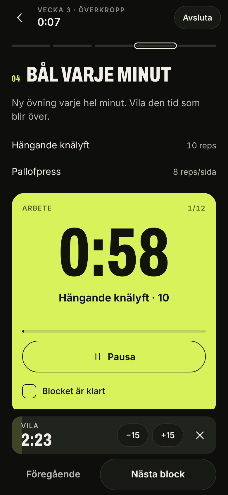
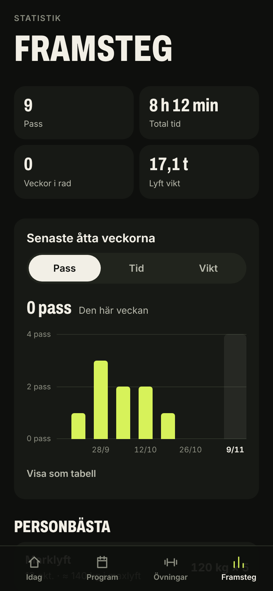

# WO

En träningsapp för mobilen med månadsprogram där varje pass går från uppvärmning via kraft och styrka till kondition, bål och nedvarvning.

| Idag | Pass | Timer | Framsteg |
| --- | --- | --- | --- |
|  |  |  |  |

## Funktioner

- **Månadsprogram** på fyra veckor (Grund, Bygg, Topp, Lätt) där set och repetitioner ändras vecka för vecka. Två program följer med: *Atlet* (gym, fyra pass i veckan) och *Hemma* (kettlebell, tre pass i veckan).
- **Guidade pass** i block. Logga vikt och repetitioner per set, få förra passets vikter som förslag och en vilotimer som startar när du bockar av ett set.
- **Timers** för intervaller, EMOM och AMRAP med ljud, vibration och varvräknare. Skärmen hålls tänd under passet.
- **Övningsbibliotek** med beskrivning, teknikpunkter och din egen historik per övning.
- **Framsteg**: pass, tid och lyft vikt per vecka, personbästa och full historik.
- **Fungerar offline** och går att lägga till på hemskärmen. All data sparas lokalt i webbläsaren och kan exporteras och importeras som fil.

## Kom igång

```bash
npm install
npm run dev      # utvecklingsserver
npm test         # enhetstester
npm run build    # produktionsbygge i dist/
```

Bygget är statiskt och använder relativa sökvägar, så `dist/` kan läggas på valfri statisk host.

## Struktur

- `src/data/` – övningar och program. Ett nytt program är en ny post i `programs.ts`.
- `src/lib/` – lagring, statistik, timerlogik och formatering.
- `src/screens/` och `src/components/` – gränssnittet.
