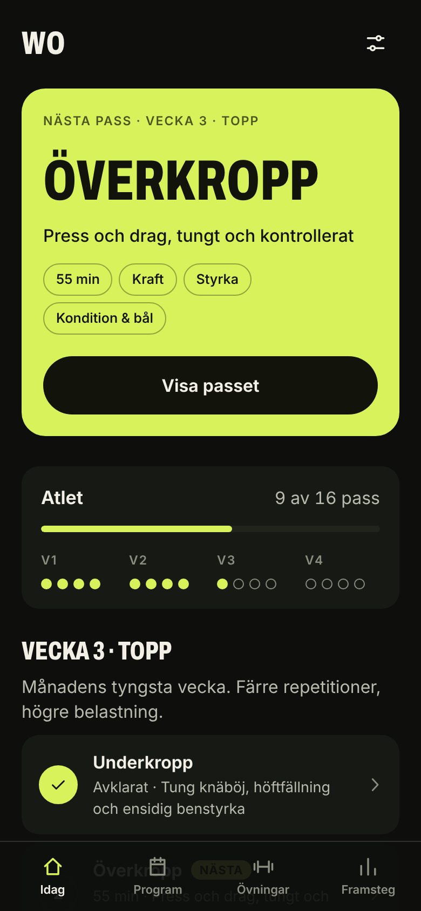
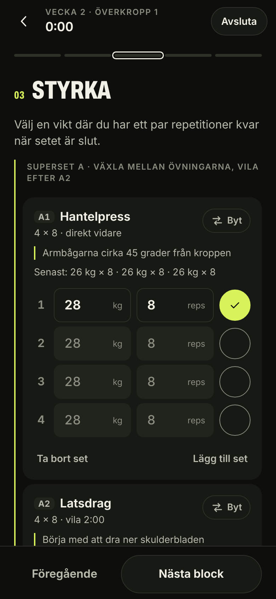
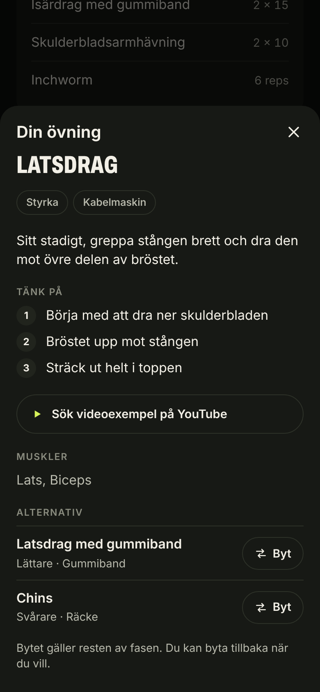
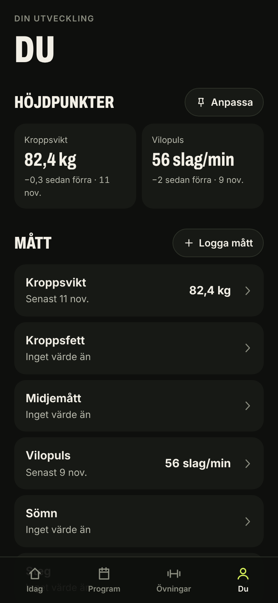

# WO

En träningsapp för mobilen byggd kring månadsfaser: fyra veckor i taget, där varje pass går från uppvärmning via kraftutveckling och styrka till finisher och nedvarvning.

Appen ligger på https://simonjsv98.github.io/WO/ och går att lägga till på hemskärmen.

| Idag | Pass | Alternativ | Du |
| --- | --- | --- | --- |
|  |  |  |  |

## Funktioner

- **Eget upplägg.** Välj gym eller hemma, två till fyra pass i veckan och vilka veckodagar du tränar. Upplägget går att ändra mitt i en fas.
- **Faser på fyra veckor.** Tre faser (Grund, Styrka, Kraft) med olika övningar, set och repetitioner. När en fas är klar går du vidare till nästa.
- **Idag.** Visar dagens pass eller vilodag, veckans planerade och avklarade pass och dina fästa mått. Ett missat pass flyttas fram till nästa träningsdag.
- **Guidade pass.** Fem block per pass, med styrkan upplagd i supersets. Logga vikt och repetitioner per set, få förra passets vikter som förslag och en vilotimer som startar när du bockar av ett set.
- **Alternativ till varje övning.** Lättare, liknande och svårare varianter med samma rörelsemönster. Byt före eller under passet; bytet gäller resten av fasen.
- **Timers** för intervaller, varje minut och max antal varv, med ljud, vibration och varvräknare.
- **Resultat.** Efter passet visas tid, set, personbästa som slogs och märken för första passet och veckor i rad.
- **Du.** Logga kroppsvikt och andra mått, fäst dem som höjdpunkter, och följ pass, tid, lyft vikt, personbästa och maxlyft per övning över tid.
- **Fungerar offline.** All data sparas lokalt i webbläsaren och kan exporteras och importeras som fil.

## Kom igång

```bash
npm install
npm run dev      # utvecklingsserver
npm test         # enhetstester
npm run build    # produktionsbygge i dist/
```

Varje push till huvudgrenen bygger, testar och publicerar appen till GitHub Pages.

## Struktur

- `src/data/exercises.ts` – övningar med rörelsemönster och nivå, som styr vilka alternativ som erbjuds.
- `src/data/programs.ts` – faserna. En fas anger en övning per plats (gym och hemma), och veckans pass byggs från det.
- `src/lib/` – lagring, schema, statistik, timerlogik och formatering.
- `src/screens/` och `src/components/` – gränssnittet.

## Stallet

I [`stallet/`](stallet/) ligger ett fristående sidoprojekt: en 3D-modell av stallet. Det har eget bygge och påverkar inte appen.
