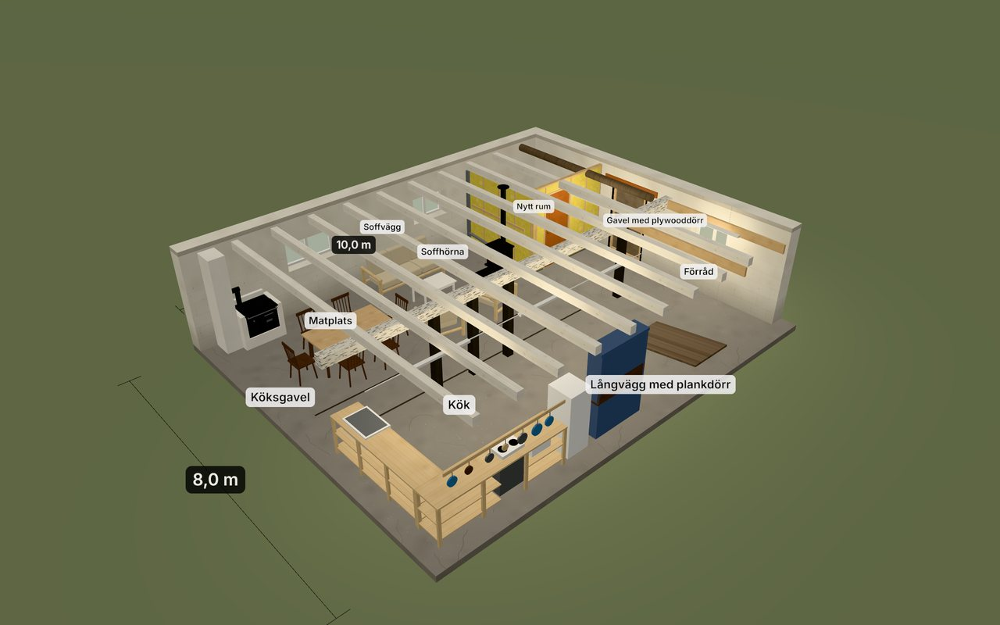
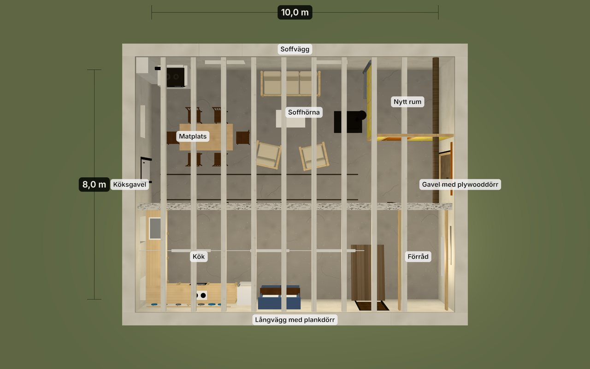
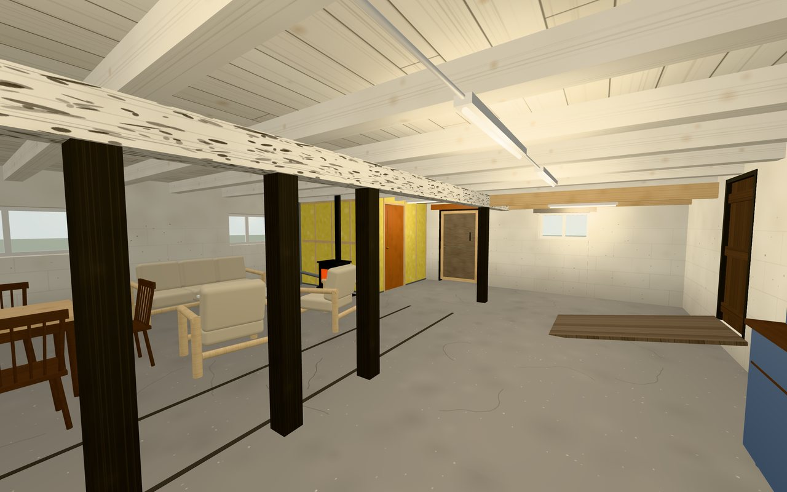
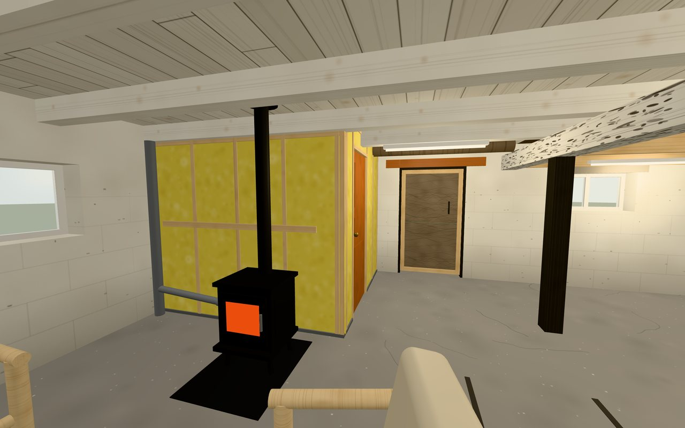

# Stallet

En 3D-modell av stallet, 8 × 10 m, tolkad från tio foton: murar, fönster och dörrar, bjälklag, bärlina med stolpar och det nya isolerade rummet i hörnet. Rummet är möblerat med matgrupp, soffgrupp, kök, inmurad vedspis och en braskamin, och möblerna går att slå av.

Projektet är fristående från träningsappen i resten av repot.

| Översikt | Plan |
| --- | --- |
|  |  |

| Från köket | Mot nya rummet |
| --- | --- |
|  |  |

## Kom igång

```bash
cd stallet
npm install
npm run dev      # utvecklingsserver
npm run build    # en enda fristående fil: dist/index.html
```

Bygget blir en enda HTML-fil som går att öppna direkt i webbläsaren eller skicka vidare.

I visaren:

- **Vyer** – översikt, plan och sex lägen inne i rummet, valda så att de motsvarar fotona.
- **Möbler** och **Takbjälkar** går att slå av och på.
- **Öppna upp utifrån** – väggar och takbrädor som står mellan kameran och rummet göms, så att man kan titta in från alla håll.
- **Ladda ner som GLB** – exporterar modellen för Blender, SketchUp och liknande.
- Dra för att snurra, scrolla eller nyp för att zooma, WASD för att gå runt.

## Mått

Alla mått ligger i [`src/dimensions.ts`](src/dimensions.ts), i meter. Modellen byggs helt från den filen, så ett uppmätt värde ändras på ett ställe.

Origo är hörnet mellan köksgaveln och soffväggen. `x` går längs soffväggen (10 m), `z` tvärs över rummet (8 m) och `y` uppåt.

Yttermåtten 8 × 10 m är givna. **Allt annat är uppskattat ur fotona, ungefär ±0,4 m.** Det som är värt att mäta upp först, eftersom fotona gav olika svar:

| Mått | Antaget | Var |
| --- | --- | --- |
| Takhöjd till brädorna | 2,35 m | `ceiling.boards` |
| Underkant bärlina | 1,92 m | `beamBottom` |
| Bärlinans avstånd från soffväggen | 4,7 m | `beam.z` |
| Stolparnas lägen från köksgaveln | 2,6 · 3,6 · 4,6 · 8,3 m | `beam.postXs` |
| Nya rummets djup längs soffväggen | 2,5 m | `newRoom.frontX` |
| Nya rummets bredd ut från soffväggen | 2,5 m | `newRoom.depthZ` |
| Fönster och dörrar, läge och storlek | se filen | `sofaWall`, `kitchenGable`, `farGable`, `kitchenWall` |

Förenklingar:

- Takbjälkarna ligger med jämnt avstånd (0,95 m) och går hela vägen över rummet. I verkligheten är de skarvade över bärlinan och ligger lite ojämnt.
- Murarna är 0,4 m tjocka överallt.
- Insidan av det nya rummet är tom.
- Golvet är plant, med bara de två skarvarna längs stolpraden markerade.

## Möbler

Lägena står under `furniture` i `src/dimensions.ts` – mittpunkt på golvet och vridning i grader – så det går fort att flytta runt saker.

- **Matgrupp** – bord med sex pinnstolar vid köksgaveln, med arbetsyta kvar framför vedspisen.
- **Soffgrupp** – tresitssoffa mot soffväggen, soffbord och två fåtöljer.
- **Kök** – öppen furubänk i vinkel med ugn, kokplatta, mikro och diskho, redskapslist på väggen, kyl/frys och det blå vitrinskåpet.
- **Vedspis** – Husqvarna-spisen i hörnet köksgavel / soffvägg, upplyft till arbetshöjd (häll på 0,86 m) och inmurad i vitputsat murverk, med murstock i hörnet upp till taket.
- **Braskamin** – gjutjärnskamin mot nya rummets vägg mot soffhörnan, centrerad på tredje synliga regeln (1,8 m från soffväggen) och vänd ut mot rummet, med eldstadsplan och rökrör rakt upp genom taket. I modellen är det 0,3 m från kaminens rygg till regelväggen och ungefär 0,25 m från röret till närmaste takbjälke, så avstånden till brännbart material behöver kontrolleras innan den placeras så på riktigt.

Murstocken och rökrörens dragning är antaganden – modellen vet inget om var det finns en rökkanal.

## Struktur

- `src/dimensions.ts` – alla mått.
- `src/build.ts` – geometrin: murar med öppningar, bjälklag, bärlina, stolpar, nya rummet.
- `src/furniture.ts` – möblerna.
- `src/textures.ts` – ytor och material, ritade i kod (inga bildfiler).
- `src/main.ts` – scen, ljus, vyer, panel och export.
