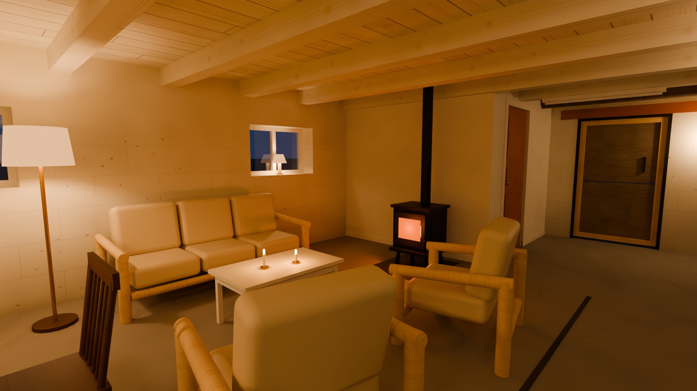
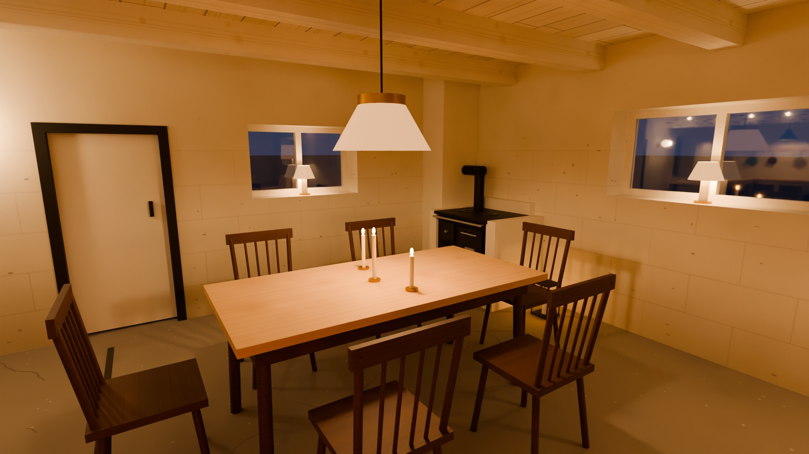
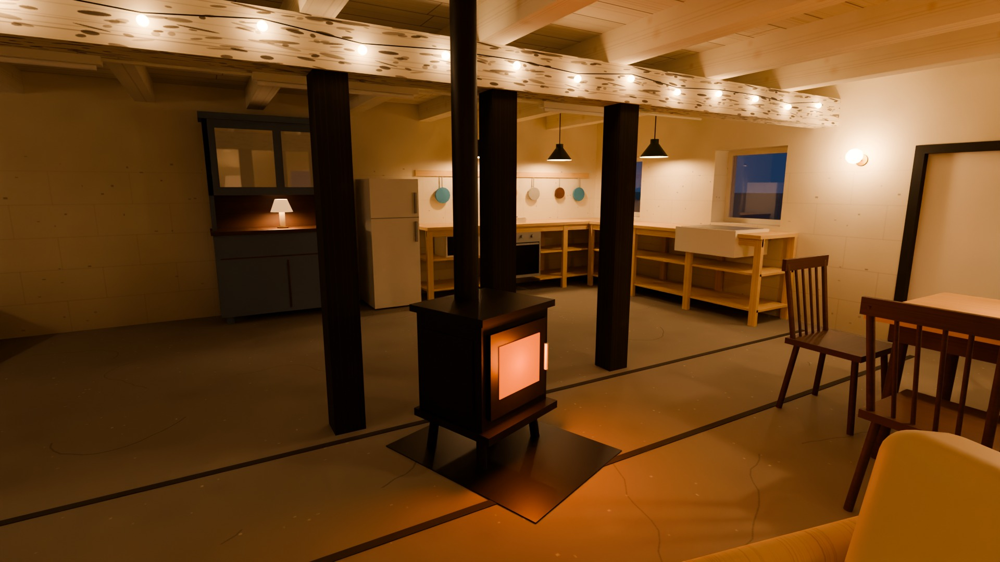
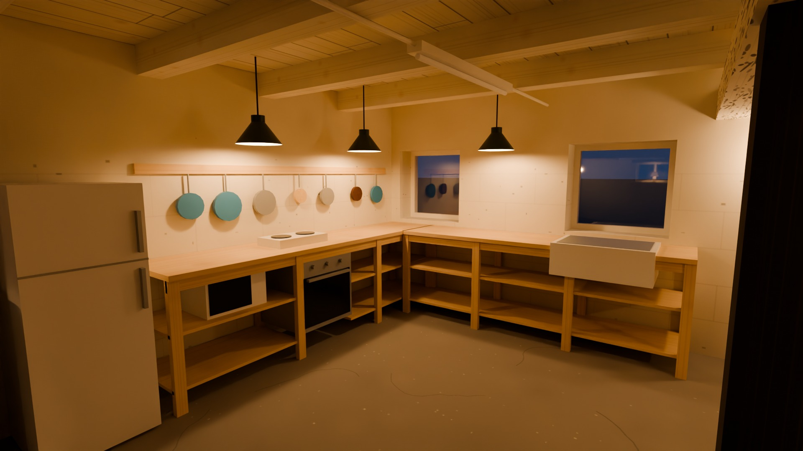
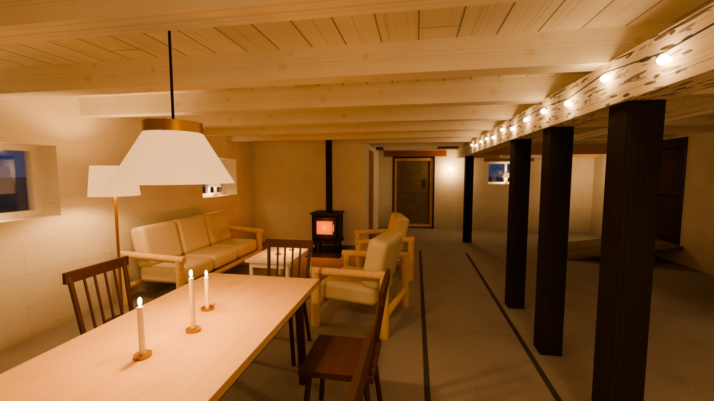
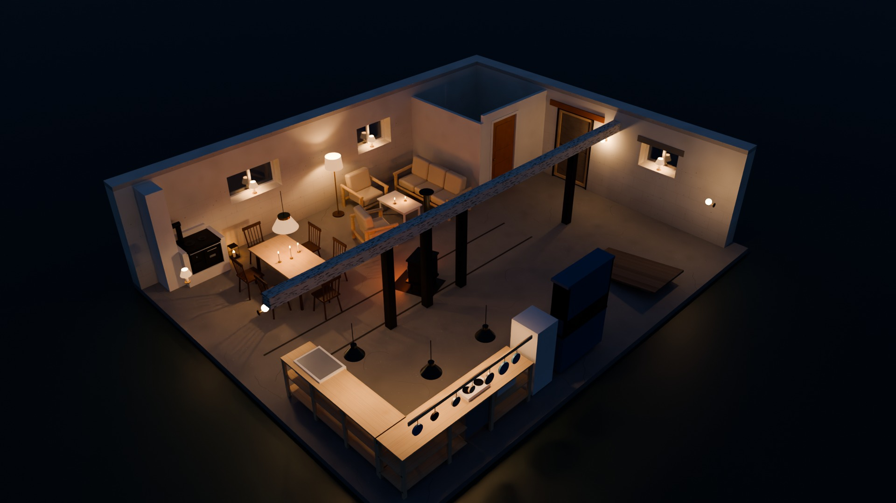

# Stallet

En 3D-modell av stallet, 9,6 × 8,0 m invändigt, uppmätt i en lidarskanning och tolkad från foton: murar, fönster och dörrar, bjälklag, bärlina med stolpar och det nya isolerade rummet i hörnet. Rummet är möblerat med matgrupp, soffgrupp, kök, inmurad vedspis och en braskamin, och har mysbelysning för kvällen. Det nya rummet visas färdigputsat.

Projektet är fristående från träningsappen i resten av repot.

| Översikt | Plan |
| --- | --- |
|  |  |

| Från köket | Mot nya rummet |
| --- | --- |
|  |  |

## Raytracade bilder

Kvällsljus, renderat med Blender Cycles i 1920 × 1080. Bilderna är från en tidigare version: rummets mått är sedan dess justerade efter lidarskanningen, möblerna har flyttats och strecken i golvet är borttagna. Skärmdumparna överst och visaren visar hur det ser ut nu. Nya bilder görs med skriptet under [Rendera själv](#rendera-själv).

| Soffhörnan | Matplatsen |
| --- | --- |
|  |  |

| Kaminen | Köket |
| --- | --- |
|  |  |

| Längs rummet | Översikt |
| --- | --- |
|  |  |

## Kom igång

```bash
cd stallet
npm install
npm run dev      # utvecklingsserver
npm run build    # en enda fristående fil: dist/index.html
```

Bygget blir en enda HTML-fil som går att öppna direkt i webbläsaren eller skicka vidare.

I visaren:

- **Vyer** – översikt, plan och sex lägen inne i rummet, valda så att de motsvarar fotona.
- **Kvällsljus** – växlar mellan mysbelysning i skymning och dagsljus med lysrören tända.
- **Möbler** och **Takbjälkar** går att slå av och på.
- **Öppna upp utifrån** – väggar och takbrädor som står mellan kameran och rummet göms, så att man kan titta in från alla håll.
- **Ladda ner som GLB** – exporterar modellen för Blender, SketchUp och liknande.
- Dra för att snurra, scrolla eller nyp för att zooma, WASD för att gå runt.

## Mått

Alla mått ligger i [`src/dimensions.ts`](src/dimensions.ts), i meter. Modellen byggs helt från den filen, så ett värde ändras på ett ställe.

Origo är hörnet mellan köksgaveln och soffväggen. `x` går längs soffväggen, `z` tvärs över rummet och `y` uppåt.

Rummets mått kommer från en lidarskanning (2026-11-14) och är avlästa på ett par centimeter när.

| Mått | Värde | Var |
| --- | --- | --- |
| Rummets längd och bredd (invändigt) | 9,60 × 8,03 m | `room` |
| Takhöjd till brädorna | 2,24 m | `ceiling.boards` |
| Underkant takbjälkar, soffsidan / kökssidan | 2,08 / 2,02 m | `sofaJoistBottom`, `kitchenJoistBottom` |
| Underkant bärlina | 1,77 m | `beam.bottom` |
| Bärlinans avstånd från soffväggen | 4,68 m | `beam.z` |
| Stolparnas lägen från köksgaveln | 2,25 · 3,43 · 4,75 · 7,65 m | `beam.postXs` |
| Nya rummet, djup längs soffväggen × bredd | 2,67 × 2,45 m | `newRoom` |
| Fönster och dörrar, läge och storlek | se filen | `sofaWall`, `kitchenGable`, `farGable`, `kitchenWall` |

Det skanningen inte ger, eller ger osäkert:

- **Rummet är inte rätvinkligt i skanningen.** Soffväggen är 9,76 m, långväggen 9,44 m, köksgaveln 7,93 m och bortre gaveln 8,12 m. Modellen är en rektangel med medelvärdena och allt annat är inpassat i den, så enskilda lägen kan skilja någon decimeter längst ut i hörnen. Skillnaden kan vara verklig eller bero på att skanningen dragit sig.
- **Golvet** lutar ungefär 1 cm per meter och buktar ±5 cm. Modellen har plant golv, och höjderna är mätta från golvet på platsen.
- **Murens tjocklek** (0,4 m) är antagen – skanningen är gjord inifrån.
- **Fönstrens djup** i muren (0,1 m) är ungefärligt; glas är svårt för lidar.
- **Nya rummets insida** är inte skannad.

Förenklingar:

- Takbjälkarna ligger på de skannade lägena, skarvade över bärlinan, men alla är raka och lika grova på var sida.
- Bärlinan är rak. I skanningen är den skarvad med en liten förskjutning mitt i rummet.
- Det nya rummet visas färdigt: vitputsade väggar, golvlist och dörrfoder, med avloppsrören inbyggda. Sätt `newRoom.finish` till `'studs'` för att se det som i fotona, med reglar och isolering.
- Golvet är plant och slätt, utan nivåskillnader och skarvar.

## Möbler

Lägena står under `furniture` i `src/dimensions.ts` – mittpunkt på golvet och vridning i grader – så det går fort att flytta runt saker. Matgruppen, soffgruppen och köket står där de står i skanningen.

- **Matgrupp** – bord med sex pinnstolar vid köksgaveln, nära hörnet mot soffväggen. Bordet står på tvären, med långsidan ut från soffväggen.
- **Soffgrupp** – i U-form: tresitssoffan med ryggen mot nya rummet, en fåtölj med ryggen mot soffväggen mellan fönstren och en mittemot soffan, med soffbordet i mitten.
- **Kök** – öppen furubänk i vinkel med ugn, kokplatta, mikro och diskho, redskapslist på väggen, kyl/frys och det blå vitrinskåpet.
- **Vedspis** – Husqvarna-spisen i hörnet köksgavel / soffvägg, 45 grader snett över hörnet och vänd ut mot rummet. Den är upplyft till arbetshöjd (häll på 0,86 m) och inmurad i vitputsat murverk, med murstock innerst i hörnet upp till taket och en murad avställningsyta ut mot väggen på var sida. Murverket når knappt 1,2 m ut längs vardera väggen.
- **Braskamin** – gjutjärnskamin framför tredje stolpen i stolpraden (räknat från köksgaveln), med ryggen nästan intill stolpen och luckan rakt mot soffväggen och soffgruppen, med eldstadsplan och rökrör rakt upp genom taket. I modellen är det ungefär 5 cm från kaminens rygg till stolpen och 6 cm från rökröret till bärlinan och närmaste takbjälke. Allt det är trä, så en riktig braskamin kan inte stå så utan avskärmning – avstånden till brännbart material måste kontrolleras först.

## Belysning

Lamporna står under `lighting` i `src/dimensions.ts`.

- Taklampa med linneskärm över matbordet och tre emaljskärmar över köksbänken.
- Golvlampa vid fåtöljen mot soffväggen, bordslampa på vitrinskåpet och små lampor i fyra av fönsternischerna.
- Tre vägglampor: vid vita dörren, vid plywooddörren och i förrådshörnan.
- Ljusslinga med klotlampor längs bärlinan.
- Levande ljus på matbordet och soffbordet, en lykta vid vedspisen och skenet från braskaminen.

Lysrören sitter kvar men är släckta i kvällsljuset.

## Rendera själv

Bilderna ovan görs i Blender med skriptet `render/render.py`:

1. Öppna `dist/index.html` direkt i en webbläsare och välj **Ladda ner som GLB**.
2. Spara ljuskällorna: kör `copy(JSON.stringify(stallet.sources))` i webbläsarens konsol och klistra in i `sources.json`.
3. Installera Blender som Python-modul (`pip install bpy`) och kör:

```bash
python render/render.py stallet.glb sources.json renders --width 1920 --samples 100
```

Vyerna, lampstyrkorna och skymningsljuset ställs in överst i skriptet. En bild i 1920 × 1080 tar några minuter på en vanlig processor.

Murstocken och rökrörens dragning är antaganden – modellen vet inget om var det finns en rökkanal.

## Struktur

- `src/dimensions.ts` – alla mått.
- `src/build.ts` – geometrin: murar med öppningar, bjälklag, bärlina, stolpar, nya rummet.
- `src/furniture.ts` – möblerna.
- `src/lighting.ts` – lamporna och listan med ljuskällor.
- `src/textures.ts` – ytor och material, ritade i kod (inga bildfiler).
- `src/main.ts` – scen, ljus, vyer, panel och export.
- `render/render.py` – raytracing i Blender Cycles.
